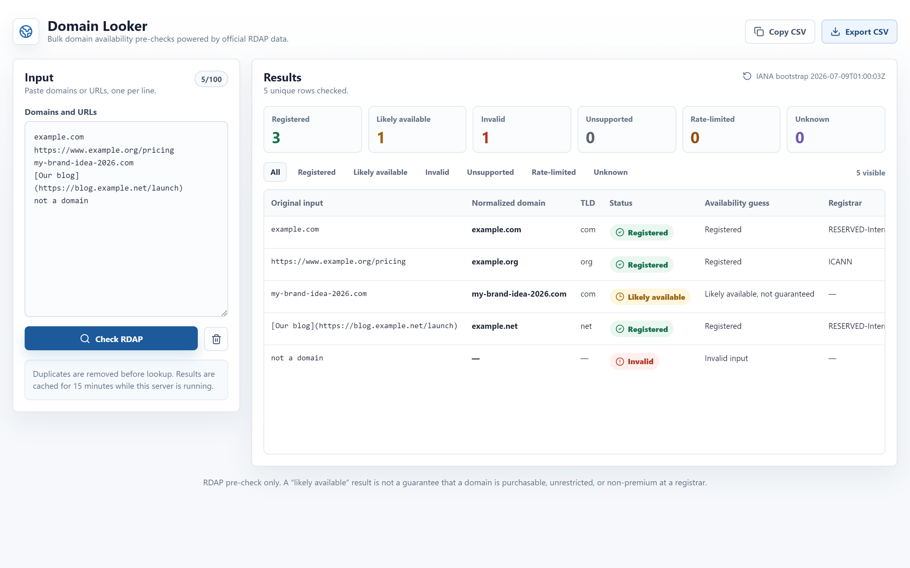

# Domain Looker

**Paste a list of domains or URLs and get their registration status in bulk, using official [RDAP](https://www.icann.org/rdap) data — no API keys, no spreadsheets, no manual WHOIS lookups.**

> **Built with:** React 19, TypeScript, Vite, Express, Zod, `tldts`, Node.js, Vitest, Testing Library, and the official IANA RDAP bootstrap plus registry RDAP services.


[](https://github.com/Krmzyn/domain-looker/actions/workflows/ci.yml)



---

## The problem

When you're brainstorming names for a project, migrating a portfolio of sites, or triaging a
messy list of URLs, you often need one simple answer for *many* inputs at once: **is this
domain already registered, or is it probably free?**

Doing that by hand is tedious. WHOIS is rate-limited, inconsistently formatted, and increasingly
redacted. Registrar search boxes check one name at a time and nudge you toward a purchase.
Domain Looker gives you a fast, honest, bulk pre-check built on **RDAP** — the modern,
structured, machine-readable successor to WHOIS that registries publish themselves.

You paste up to 100 domains or URLs, click one button, and get a sortable table of registration
statuses, registrars, and nameservers that you can filter and export to CSV.

## Features

- **Bulk lookups** — check up to 100 domains or URLs in a single run.
- **Forgiving input** — paste bare domains (`example.com`), full URLs
  (`https://www.example.org/pricing`), or even Markdown links
  (`[Our blog](https://blog.example.net/launch)`). Each line is normalized down to its
  registrable domain (scheme, `www`, paths, ports, and trailing punctuation are stripped; IDNs
  are converted to punycode).
- **Official RDAP data** — statuses come from the registry's own RDAP server, resolved via the
  live [IANA RDAP bootstrap](https://data.iana.org/rdap/dns.json).
- **Clear status model** — every row is one of: `Registered`, `Likely available`, `Invalid`,
  `Unsupported`, `Rate-limited`, or `Unknown`, with a plain-English note explaining why.
- **Registrar & nameservers** — registered domains show the sponsoring registrar and nameservers
  parsed from the RDAP response.
- **Filter & summarize** — click any status card to filter; see live counts per status.
- **CSV export** — copy to clipboard or download the (filtered) results as CSV.
- **De-duplication & caching** — duplicate inputs are collapsed before lookup, and results are
  cached in memory for 15 minutes to avoid hammering RDAP servers.
- **Polite by design** — conservative global concurrency and per-host serialization keep the tool
  a good RDAP citizen.
- **Demo mode** — run entirely offline with simulated results, so you can explore the UI without
  touching the network.

## Example workflow

1. Start the app (see [Getting started](#getting-started)) and open <http://127.0.0.1:5173>.
2. Paste a mix of ideas and existing links into the input box, one per line:
   ```
   example.com
   https://www.example.org/pricing
   my-brand-idea-2026.com
   [Our blog](https://blog.example.net/launch)
   ```
3. Click **Check RDAP**. Domain Looker normalizes each line, removes duplicates, and queries the
   correct RDAP server for each TLD.
4. Read the table: `example.com` and `example.org` come back **Registered** (with registrar and
   nameservers), while `my-brand-idea-2026.com` is **Likely available**.
5. Click the **Likely available** card to filter to just the open candidates, then **Export CSV**
   to hand the shortlist off.

## Architecture

Domain Looker is a small full-stack TypeScript app: a React single-page frontend and an Express
API that does the RDAP work.

```
┌──────────────────────────┐     POST /api/check      ┌───────────────────────────┐
│  Frontend (React + Vite) │ ───────────────────────▶ │   Backend (Express + TS)  │
│                          │   { inputs: string[] }   │                           │
│  • paste / normalize UI  │ ◀─────────────────────── │  • zod request validation │
│  • status table + filter │      CheckResponse       │  • input normalization    │
│  • CSV copy / export     │                          │  • RDAP orchestration      │
└──────────────────────────┘                          │  • in-memory result cache │
                                                       └─────────────┬─────────────┘
                                                                     │ HTTPS
                                                    ┌────────────────▼────────────────┐
                                                    │  IANA RDAP bootstrap + registry  │
                                                    │  RDAP servers (public, no auth)  │
                                                    └──────────────────────────────────┘
```

**Frontend** (`src/`) — React 19 + Vite 7. A single `App` component manages the input, calls
`POST /api/check`, and renders the results table, status summary, filters, and CSV export. During
development, Vite proxies `/api` to the backend on port 3001.

**Backend** (`server/`) — Express 4 + TypeScript, run with `tsx` in development.

| File | Responsibility |
| --- | --- |
| `server/index.ts` | Entry point: loads `.env`, selects live vs. demo checker, serves the built frontend in production. |
| `server/app.ts` | Express app + `POST /api/check` route with zod validation (max 100 inputs, 80 KB body). |
| `server/normalization.ts` | Turns arbitrary input (URLs, Markdown links, IDNs) into a registrable domain + TLD. |
| `server/rdapService.ts` | The live checker: IANA bootstrap, RDAP requests, status mapping, caching, concurrency. |
| `server/demoService.ts` | Offline stand-in that returns deterministic simulated results. |
| `server/results.ts` | Shared helpers for building result rows and summaries. |
| `server/registrarAvailability.ts` | A typed extension point (currently a no-op stub) for a future registrar availability/pricing provider. |

## RDAP and provider behavior

Domain Looker never guesses at where to look. For each request it:

1. **Loads the IANA RDAP bootstrap** (`https://data.iana.org/rdap/dns.json`) and caches it for
   24 hours. This maps every TLD to its authoritative RDAP base URL. If a refresh fails, the last
   good copy is reused.
2. **Resolves each domain's TLD** to an RDAP base URL (preferring `https://`).
3. **Requests `{base}/domain/{name}`** with an `application/rdap+json` `Accept` header and maps the
   response to a status:

| RDAP response | Status | Meaning |
| --- | --- | --- |
| `200` with a `domain` object | **Registered** | The registry returned a domain record (registrar & nameservers are parsed out). |
| `404` | **Likely available** | The registry has no record. A *pre-check only* — not a guarantee of purchasability. |
| `429` | **Rate-limited** | The RDAP server asked us to slow down (any `Retry-After` is surfaced). |
| Other non-2xx / bad body | **Unknown** | The lookup didn't produce a reliable answer. |
| TLD missing from bootstrap | **Unsupported** | No RDAP server is published for that TLD yet. |
| Input can't be normalized | **Invalid** | The line isn't a usable domain. |

> **A "Likely available" result is not a guarantee.** RDAP only tells you whether a registry has a
> record. A domain can be unregistered in RDAP yet still be premium-priced, reserved, blocked, or
> otherwise not purchasable at a registrar. Always confirm at a registrar before you rely on it.

The `registrarAvailability` module is a deliberate seam: it defines the interface a real registrar
availability/pricing provider would implement, but ships as `null` so the app has **no paid
dependencies**. See the [Roadmap](#roadmap).

## Rate limiting and error handling

- **Politeness** — lookups run with a global concurrency of 4 and **at most one in-flight request
  per RDAP host**, so a batch of many `.com` domains is spread out rather than fired in a burst.
- **Timeouts** — RDAP requests time out after 8 seconds, bootstrap after 10, so one slow registry
  can't hang the batch.
- **Isolation** — one bad row never fails the whole request. Invalid input, unsupported TLDs,
  timeouts, and server errors each become a labeled row; the rest of the batch still returns.
- **No leaked internals** — unexpected server errors are logged server-side and returned to the
  client as a generic message (no stack traces or filesystem paths).
- **Graceful degradation** — if the IANA bootstrap can't be loaded at all, affected rows come back
  as `Unknown` with an explanatory warning banner instead of crashing.

## Getting started

### Prerequisites

- **Node.js ≥ 20.19** (or ≥ 22.12) and npm. Built and tested on Node 24.
- Outbound HTTPS access to `data.iana.org` and public RDAP servers — *or* use
  [demo mode](#demo-mode-offline), which needs no network.

### Installation

```bash
git clone https://github.com/Krmzyn/domain-looker.git
cd domain-looker
npm install
```

### Development

Runs the Vite dev server and the API together with live reload:

```bash
npm run dev
```

- Frontend: <http://127.0.0.1:5173>
- API: <http://127.0.0.1:3001>

Vite proxies `/api` to the backend automatically, so you only need to open the frontend URL.

> **Windows convenience:** double-clicking `Launch Domain Looker.cmd` installs dependencies (if
> needed) and starts `npm run dev`.

#### Demo mode (offline)

Explore the full UI with simulated, deterministic results and **no network calls**:

```bash
npm run dev:demo
```

Demo mode reuses the real input normalization and de-duplication, so the app behaves identically —
only the RDAP results are faked. A banner in the UI makes the mode obvious.

### Environment variables

All variables are **optional** — Domain Looker needs no keys, tokens, or database. Copy the
template and edit if you like:

```bash
cp .env.example .env
```

| Variable | Default | Description |
| --- | --- | --- |
| `PORT` | `3001` | Port the Express server (API + built frontend) listens on. |
| `DOMAIN_LOOKER_DEMO` | *(off)* | Set to `1` or `true` to force demo mode. Equivalent to the `--demo` flag. |

The backend loads `.env` automatically on startup via Node's built-in loader (no dependency).

### Testing

```bash
npm test          # run the Vitest unit + integration suite once
npm run typecheck # TypeScript checks for both frontend and backend
```

Tests cover input normalization, the RDAP status mapping (with a mocked `fetch`), the API contract
(via `supertest`), CSV escaping, the demo checker, and the React UI (via Testing Library + jsdom).

### Production build

```bash
npm run build     # type-check, compile the server to dist-server/, build the frontend to dist/
npm start         # serve the built frontend + API from a single process (defaults to :3001)
```

`npm run preview` does both in one step. In production the Express server serves the static
frontend from `dist/`, so everything runs on one port:

```bash
# Example: build once, then serve on port 8080
npm run build
PORT=8080 npm start
# open http://127.0.0.1:8080
```

## Privacy and data handling

Domain Looker is designed to hold onto as little as possible:

- **No accounts, no tracking, no analytics, no cookies.** The frontend talks only to its own API.
- **No persistence.** Results live in an **in-memory cache for 15 minutes** and are gone when the
  server stops. Nothing is written to disk or a database.
- **The domains you check leave your server** only as RDAP lookups to the relevant public registry
  RDAP endpoints (and the IANA bootstrap file). That's inherent to how RDAP works — the registry
  has to answer the query. If a list of domains is sensitive, run in [demo mode](#demo-mode-offline)
  or against a private RDAP mirror.
- **No secrets to leak.** There are no API keys or credentials anywhere in the project.

## Known limitations

- **Pre-check, not a purchase check.** "Likely available" reflects RDAP only; premium, reserved,
  and restricted names can still be unbuyable. See the RDAP note above.
- **RDAP coverage is uneven.** gTLDs are well covered; some ccTLDs still publish no RDAP server and
  come back as `Unsupported`.
- **In-memory, single-process cache.** No shared/persistent cache — each server instance caches on
  its own, and restarts clear it.
- **100 inputs per request** by design, to stay polite and responsive.
- **Not a hardened multi-tenant service.** It's a self-hosted tool: no auth, no per-user rate
  limiting. Run it somewhere you trust.

## Roadmap

- Optional **registrar availability/pricing provider** implementing the existing
  `registrarAvailability` interface (turn "likely available" into "available for $X").
- **Persistent / shared caching** (e.g. Redis) for multi-instance deployments.
- **Env-configurable** concurrency and timeouts.
- **File import** (upload a `.txt`/`.csv` of domains) and larger batch sizes with pagination.
- **Saved lists & re-checks** to watch a set of domains over time.
- **Dark mode.**

## Contributing

Contributions are welcome — see [CONTRIBUTING.md](CONTRIBUTING.md) for setup and the checks CI
runs. Security reports go through the process in [SECURITY.md](SECURITY.md).

## License

[MIT](LICENSE) © Alex Jardine

Created by [Alex Jardine](https://github.com/Krmzyn).
