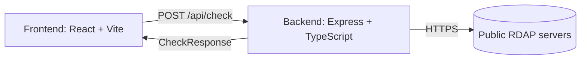

# Architecture

[Back to the README](../README.md)

## Overview

Domain Looker is a small full-stack TypeScript app: a React single-page frontend and an Express
API that does the RDAP work.

**Frontend** (`src/`): React 19 + Vite 7. A single `App` component manages the input, calls
`POST /api/check`, and renders the results table, status summary, filters, and CSV export. During
development, Vite proxies `/api` to the backend on port 3001.

**Backend** (`server/`): Express 4 + TypeScript, run with `tsx` in development.

| File | Responsibility |
| --- | --- |
| `server/index.ts` | Entry point: loads `.env`, selects live vs. demo checker, serves the built frontend in production. |
| `server/app.ts` | Express app + `POST /api/check` route with zod validation (max 100 inputs, 80 KB body). |
| `server/normalization.ts` | Turns arbitrary input (URLs, Markdown links, IDNs) into a registrable domain + TLD. |
| `server/rdapService.ts` | The live checker: IANA bootstrap, RDAP requests, status mapping, caching, concurrency. |
| `server/demoService.ts` | Offline stand-in that returns deterministic simulated results. |
| `server/results.ts` | Shared helpers for building result rows and summaries. |
| `server/registrarAvailability.ts` | A typed extension point (currently a no-op stub) for a future registrar availability/pricing provider. |

## RDAP and provider behavior

Domain Looker never guesses at where to look. For each request it:

1. Loads the IANA RDAP bootstrap (`https://data.iana.org/rdap/dns.json`) and caches it for
   24 hours. This maps every TLD to its authoritative RDAP base URL. If a refresh fails, the last
   good copy is reused.
2. Resolves each domain's TLD to an RDAP base URL (preferring `https://`).
3. Requests `{base}/domain/{name}` with an `application/rdap+json` `Accept` header and maps the
   response to a status:

| RDAP response | Status | Meaning |
| --- | --- | --- |
| `200` with a `domain` object | Registered | The registry returned a domain record (registrar & nameservers are parsed out). |
| `404` | Likely available | The registry has no record. A *pre-check only*, not a guarantee of purchasability. |
| `429` | Rate-limited | The RDAP server asked us to slow down (any `Retry-After` is surfaced). |
| Other non-2xx / bad body | Unknown | The lookup didn't produce a reliable answer. |
| TLD missing from bootstrap | Unsupported | No RDAP server is published for that TLD yet. |
| Input can't be normalized | Invalid | The line isn't a usable domain. |

> [!NOTE]
> A "Likely available" result is not a guarantee. RDAP only tells you whether a registry has a
> record. A domain can be unregistered in RDAP yet still be premium-priced, reserved, blocked, or
> otherwise not purchasable at a registrar. Always confirm at a registrar before you rely on it.

The `registrarAvailability` module is a deliberate seam: it defines the interface a real registrar
availability/pricing provider would implement, but ships as `null` so the app has **no paid
dependencies**. See the [Roadmap](usage.md#roadmap).

## Rate limiting and error handling

- **Politeness**: lookups run with a global concurrency of 4 and **at most one in-flight request
  per RDAP host**, so a batch of many `.com` domains is spread out rather than fired in a burst.
- **Timeouts**: RDAP requests time out after 8 seconds, bootstrap after 10, so one slow registry
  can't hang the batch.
- **Isolation**: one bad row never fails the whole request. Invalid input, unsupported TLDs,
  timeouts, and server errors each become a labeled row; the rest of the batch still returns.
- **No leaked internals**: unexpected server errors are logged server-side and returned to the
  client as a generic message (no stack traces or filesystem paths).
- **Graceful degradation**: if the IANA bootstrap can't be loaded at all, affected rows come back
  as `Unknown` with an explanatory warning banner instead of crashing.
